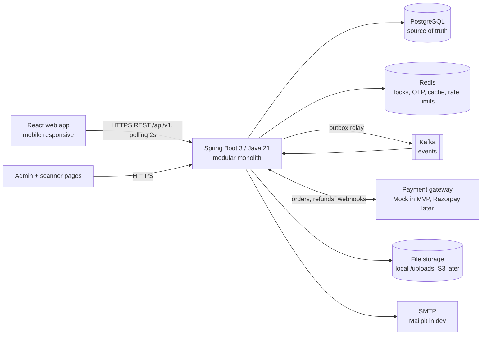
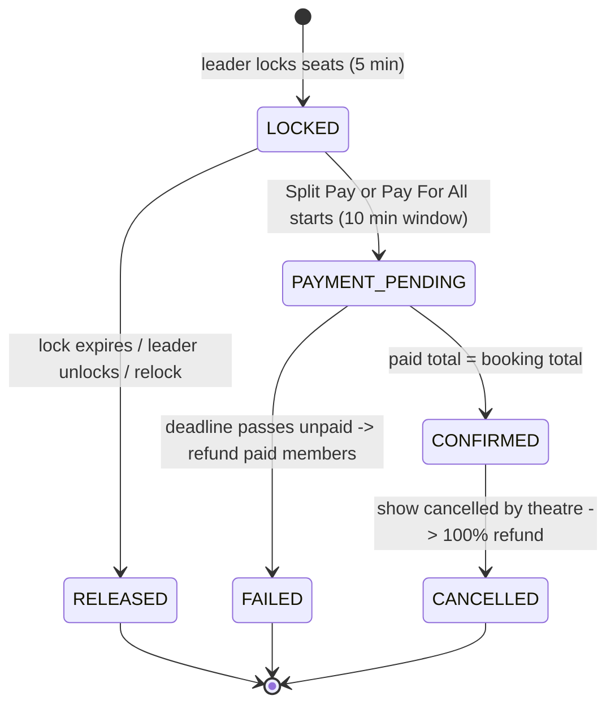

# Ticktit - Architecture - v4

## 1. System Overview



**One rule to remember:** PostgreSQL decides who owns a seat and where every rupee went. Redis only holds short-lived state. Kafka only carries side effects (emails, refunds, analytics).

## 2. Backend Modules (ADR-007)

```
com.ticktit
├── core            (vertical-agnostic, never imports a vertical)
│   ├── auth        users, JWT, refresh tokens, email OTP, Google sign-in, rate limits
│   ├── group       groups, members, invite codes, preview
│   ├── booking     bookings, booking_units, state machine, scheduler
│   ├── payment     PaymentGateway interface, idempotency, webhooks, reconciliation
│   ├── refund      refunds, retry, reconciliation
│   ├── ticket      QR tokens, check-in, PDF
│   ├── notification  email, in-app, WhatsApp links (Kafka consumers)
│   └── platform    outbox relay, processed events, requestId, audit log
├── vertical
│   └── movie       cities, theatres, screens, screen_seats, movies, shows, show_prices, show_seats, seat map,
│                   InventoryProvider impl (hold/release/confirm/price/suggest)
└── admin           catalog CRUD, show cancel, booking search
```

The core calls a vertical only through this interface:

```java
public interface InventoryProvider {
    ItemType type();                                   // SHOW (MVP)
    HoldResult hold(long itemId, List<String> units, long groupId, Duration ttl); // all-or-nothing
    void extend(long itemId, List<String> units, long groupId, Duration ttl);
    void release(long itemId, List<String> units, long groupId);
    ConfirmResult confirm(long itemId, List<String> units, long bookingId);      // conditional DB update
    PriceQuote price(long itemId, List<String> units);  // frozen into price_snapshot
    Optional<List<String>> suggestAlternative(long itemId, List<String> wanted);
}
```

## 3. Booking State Machine (owner: booking module)



Group status is separate and simpler: **OPEN** (joinable, can lock) → **BOOKED** (a booking CONFIRMED) or **CANCELLED** (leader deleted it). FAILED/RELEASED bookings leave the group OPEN.

Rules:
- Only one active booking (LOCKED or PAYMENT_PENDING) per group - enforced by a partial unique index.
- Every transition goes through `Booking.transitionTo(newState)`, which rejects illegal moves and is guarded by a `@Version` column (optimistic locking), so a webhook and the scheduler cannot both move the same booking.

## 4. Critical Flows

### 4.1 Lock (`POST /bookings/lock`)
1. Check: caller is leader, group OPEN, 1-8 seats, no PAYMENT_PENDING booking.
2. Check Postgres: none of the seats are BOOKED.
3. Redis Lua script: for each seat `SET lock:show:{id}:seat:{no} {groupId} NX PX 300000`; if any fails, delete the ones just set and return the taken seats. One script = atomic all-or-nothing.
4. Insert booking LOCKED with `lock_expires_at`, `price_snapshot`, `booking_units` (default assignment). Return 200.
5. On conflict: return 409 + `alternative` from `suggestAlternative` (nearest adjacent block, same size and category).

### 4.2 Split Pay
1. `POST /payments/split` → booking PAYMENT_PENDING, `payment_deadline = now + 10 min`, Redis keys extended to deadline + 60 s, shares computed from `booking_units`.
2. Member `POST /payments/pay` (Idempotency-Key) → payment PENDING + gateway order → UI opens checkout (MVP: mock page asking for a VPA).
3. Gateway → `POST /webhooks/payment` (HMAC signature). In one transaction: store raw event in `webhook_events` (unique event ID; duplicates ignored), set payment SUCCESS/FAILED, write outbox `payment.succeeded`.
4. Same transaction checks the total: if paid = total → confirm (4.3).
5. Scheduler (every 15 s): PAYMENT_PENDING past deadline → FAILED → release seats → create refunds → outbox `booking.failed`.

### 4.3 Confirm (single transaction)
```sql
UPDATE show_seats SET status = 'BOOKED', booking_id = :bookingId
 WHERE show_id = :showId AND seat_no IN (:seats) AND status = 'AVAILABLE';
-- rows updated must equal number of seats, else roll back and fail the booking
```
Then booking CONFIRMED, group BOOKED, tickets inserted, outbox `booking.confirmed`. After commit: delete Redis lock keys.

### 4.4 Refund
Booking FAILED / CANCELLED or member removed → `refunds` rows (INITIATED) + outbox `refund.requested` in the same transaction → refund consumer calls `gateway.refund()` with idempotency reference `refund-{refundId}` → SUCCESS/FAILED via webhook or response → retries 3 times with backoff → FAILED + admin alert. Reconciliation job re-checks stuck refunds every 5 min.

## 5. Events (Kafka) - via Transactional Outbox (ADR-008)

| Topic | Key | Producer trigger | Consumers |
|---|---|---|---|
| `payment.succeeded` | bookingId | Verified webhook | notification (payment email) |
| `booking.confirmed` | bookingId | Confirm transaction | notification (QR email to all), analytics |
| `booking.failed` | bookingId | Deadline passed | notification (leader + members) |
| `booking.cancelled` | bookingId | Show cancelled | notification |
| `refund.requested` | refundId | Failure / cancel / removal / late payment | refund consumer (gateway call) |
| `refund.completed` | refundId | Refund SUCCESS/FAILED | notification, admin alert on FAILED |
| `group.reminder` | groupId | Remind / nudge / cover prompt | notification |
| `*.DLT` | same | Consumer failed after retries | admin replay |

Every event: `eventId` (UUID), `occurredAt`, `requestId`, `payload`. Consumers record `(consumer, eventId)` in `processed_events` → idempotent. The MVP may swap Kafka for an in-memory publisher behind the same `EventPublisher` interface (ADR-004), but the outbox stays.

## 6. Redis Keys

| Key | Value | TTL | Purpose |
|---|---|---|---|
| `lock:show:{showId}:seat:{seatNo}` | groupId | 300 s, extended to window + 60 s | Seat lock |
| `seats:show:{showId}` | seat map JSON | 60 s | Cache, evicted on lock/unlock/confirm |
| `otp:{challengeId}` | hash of OTP + user id + attempts | 300 s | Email OTP (login / register) |
| `otp:cooldown:{email}` | 1 | 60 s | Resend cooldown |
| `rl:login:acct:{email}` / `rl:login:ip:{ip}` | counter | 15 min | Login rate limit |
| `rl:remind:{groupId}:{userId}` | 1 | 60 s | Remind limit |
| `refresh:revoked:{familyId}` | 1 | 7 days | Refresh token family revoked |

## 7. Concurrency Control (three layers)

1. **Redis SET NX** in one Lua script → only one group holds a seat at a time.
2. **Conditional UPDATE on confirm** (`... AND status = 'AVAILABLE'`, row count check) → even if Redis loses a key, a seat can be BOOKED only once.
3. **Optimistic locking** (`@Version`) on bookings → webhook vs scheduler races cannot both win.

Payments: idempotency key per attempt (ADR-010) + UNIQUE `gateway_order_id`, `gateway_txn_id`, `webhook_events.gateway_event_id`.

## 8. Scalability

- **MVP:** single app instance, Docker Compose (app, postgres, redis, kafka in KRaft mode, mailpit). Target 100 concurrent users.
- **Phase 2:** 2+ app instances behind a load balancer (stateless: tokens + Redis); scheduler protected with ShedLock so only one instance runs it; read replica for catalog; WebSocket via a broker.
- **Later:** microservices extracted one at a time (notification → payment/refund → catalog → inventory per vertical → booking/group).

## 9. Security (summary - THREAT-MODEL.md)

BCrypt passwords; 15-min access JWT (Bearer) + rotating refresh cookie (max 7 days); email OTP on every password login, hashed with attempt limits; Google ID tokens verified server-side; login rate limits (429); webhook HMAC verification; signed QR tokens; strict CORS; Bean Validation on every request; JPA only (no string-built SQL); no passwords/OTPs/tokens in logs; admin actions audited.

## 10. Observability

- JSON logs with `requestId` (MDC), propagated in Kafka headers.
- Spring Actuator `/actuator/health` (db, redis, kafka) + Micrometer metrics: `locks.created`, `locks.conflicts`, `payments.succeeded`, `payments.failed`, `refunds.failed`, `outbox.lag.seconds`.
- Alerts (MVP: log ERROR + admin email): refund FAILED, outbox lag > 60 s, confirm row-count mismatch.
